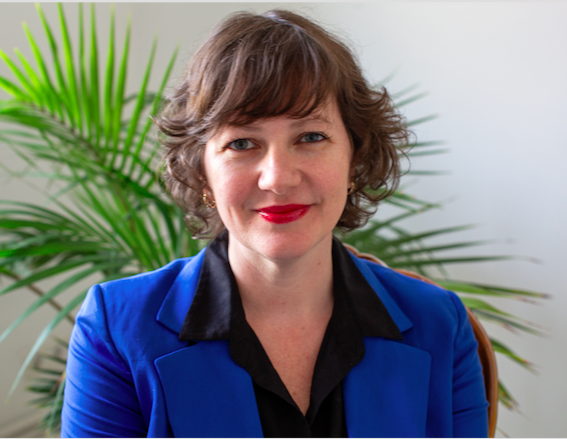

::: {.home-hero}

::: {.home-hero-copy}

# Viviane Hummes

Professora e pesquisadora em Educação Matemática · UFSC

<a href="https://orcid.org/0000-0003-2031-8238" target="_blank" rel="noopener noreferrer" aria-label="ORCID" title="ORCID">iD</a>
<a href="mailto:vivihummes@gmail.com" aria-label="E-mail" title="E-mail"><i class="bi bi-envelope" aria-hidden="true"></i></a>

Pesquisadora em Educação Matemática, com atuação na formação de professores que ensinam matemática e no desenvolvimento profissional docente. Investiga a reflexão sobre a prática pedagógica, o *Lesson Study* e os critérios de idoneidade didática.

Doutora em Didática da Matemática pela Universitat de Barcelona, onde realizou pós-doutorado com bolsa Margarita Salas. Mestra e licenciada em Matemática pela UFRGS.

::: {.research-tags}

Formação de professores
Lesson Study
Idoneidade didática
Desenvolvimento profissional
Educação Matemática Crítica
Reflexão sobre a prática

:::

:::

::: {.home-hero-image}

{loading="eager"}

:::

:::
